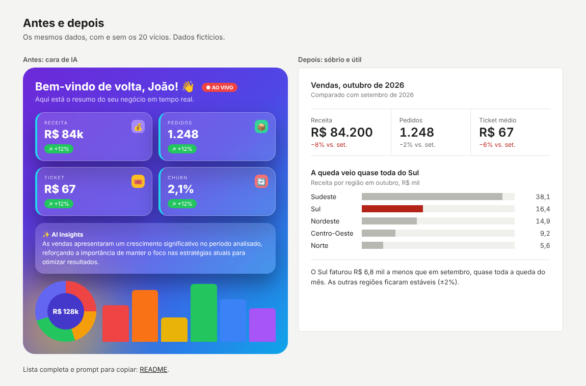

# Dashboards that don't look AI-made

**20 signs your dashboard was made by AI, and a ready-to-paste prompt for Claude, ChatGPT, Cursor or Copilot that avoids all of them.**

[🇧🇷 Português](README.md) | 🇺🇸 English

Asked an AI for a dashboard and got a purple gradient, glass cards, ✨ "AI Insights" and "Welcome back, John! 👋"? This repo is a set of design rules to make it stop.

👉 **[See the live before/after](https://htmlpreview.github.io/?https://github.com/guilhermeforprojeto/dashboard-sem-cara-de-ia/blob/main/examples/antes-depois.html)**: same data, with and without the 20 habits (page in Portuguese).

---

## The 20 signs

| # | Sign | # | Sign |
|---|---|---|---|
| 1 | Purple and blue gradient | 11 | Sparkle icon ✨ |
| 2 | Neon on black | 12 | Donut with the total in the middle |
| 3 | Glass effect on cards | 13 | Rainbow charts |
| 4 | Oversized shadows | 14 | "Sales by month" titles |
| 5 | An eyebrow on every heading | 15 | Tiny sparklines |
| 6 | "Live" tag | 16 | "Welcome back" |
| 7 | Colorful chips | 17 | Colored stripe on the card edge |
| 8 | Colored icon on every KPI | 18 | Decorative sidebar |
| 9 | Green pill with an arrow | 19 | Filter that doesn't filter |
| 10 | Emojis in headings | 20 | Insight nobody reads |

## The prompt

Copy [`prompts/en.md`](prompts/en.md) and paste it wherever your AI reads instructions.

## Where to paste it

| Tool | Where |
|---|---|
| **Claude** | Project → *Project instructions* (or your profile preferences) |
| **Claude Code** | The repo's `CLAUDE.md` |
| **ChatGPT** | *Custom instructions*, or a GPT's / Project's instructions |
| **Cursor** | A file in `.cursor/rules/` (e.g. `dashboard.mdc`) |
| **GitHub Copilot** | `.github/copilot-instructions.md` |
| **Other agents** | `AGENTS.md` at the project root |

## Contributing

Spotted a 21st sign? Open an issue or a pull request. Before/after examples are welcome in [`examples/`](examples/).

If this helped, a ⭐ helps others find it.

## Credits

The list of 20 signs comes from a TikTok video by **[@prof.julianofaccioni](https://www.tiktok.com/@prof.julianofaccioni)**. The "Do this instead" section, the before/after example and the English version were added here.

## License

[CC BY 4.0](LICENSE): use, copy, adapt and redistribute freely, commercially too. Just credit the source with a link to this repo.
