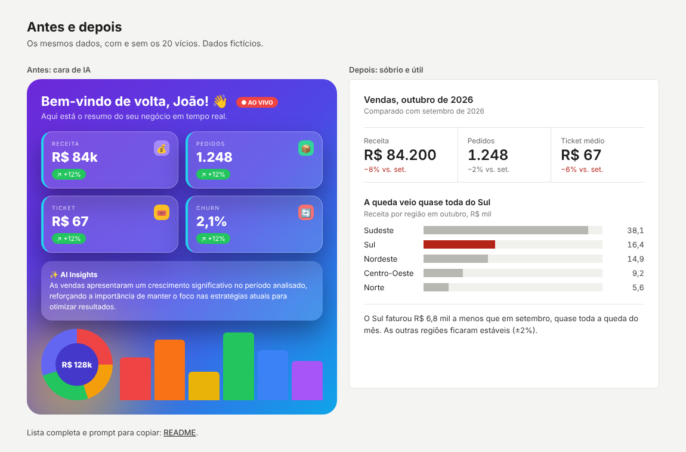

# Dashboard sem cara de IA

**20 sinais de que o seu dashboard foi feito por IA, e um prompt pronto para colar no Claude, ChatGPT, Cursor ou Copilot e evitar todos eles.**

🇧🇷 Português | [🇺🇸 English](README.en.md)

Pediu um dashboard para uma IA e veio gradiente roxo, card de vidro, ✨ "AI Insights" e "Bem-vindo de volta, João! 👋"? Este repositório é um conjunto de regras de design para a IA parar de fazer isso.

👉 **[Veja o antes e depois ao vivo](https://htmlpreview.github.io/?https://github.com/guilhermeforprojeto/dashboard-sem-cara-de-ia/blob/main/examples/antes-depois.html)**: os mesmos dados, com e sem os 20 vícios.



---

## Os 20 sinais

| # | Sinal | # | Sinal |
|---|---|---|---|
| 1 | Gradiente roxo e azul | 11 | Ícone de brilho ✨ |
| 2 | Neon em cima de preto | 12 | Rosca com o total no meio |
| 3 | Efeito de vidro nos cards | 13 | Arco-íris nos gráficos |
| 4 | Sombra desproporcional | 14 | Título "Vendas por mês" |
| 5 | Eyebrow em todo título | 15 | Sparkline pequeninha |
| 6 | Tag de "ao vivo" | 16 | "Bem-vindo de volta" |
| 7 | Chips coloridinhos | 17 | Faixa colorida na borda |
| 8 | Ícone colorido nos KPIs | 18 | Menu lateral de enfeite |
| 9 | Pílula verde com setinha | 19 | Filtro que não filtra |
| 10 | Emoji nos títulos | 20 | Insight que ninguém lê |

## O prompt

Copie o bloco abaixo (ou o arquivo [`prompts/pt-BR.md`](prompts/pt-BR.md)) e cole onde a sua IA lê instruções.

```markdown
## Diretrizes de design para dashboards e interfaces de dados

Ao criar dashboards, painéis ou qualquer interface com dados, evite os vícios visuais típicos de interface gerada por IA. Priorize clareza, hierarquia e função em vez de enfeite.

### NÃO USE

1. Gradientes roxo/azul ou fundos "tech" genéricos
2. Neon sobre fundo preto
3. Glassmorphism (efeito de vidro/blur nos cards)
4. Sombras grandes ou exageradas
5. "Eyebrow" (rótulo pequeno em caixa alta) acima de todo título
6. Tags de "ao vivo"/"live" sem dado realmente em tempo real
7. Chips/badges coloridos para tudo
8. Ícones coloridos decorando cada KPI
9. Pílula verde com setinha (+12%) em todo número
10. Emojis em títulos e seções
11. Ícone de brilho (✨) ou seções "AI Insights"
12. Gráfico de rosca com o total no meio
13. Paleta arco-íris nos gráficos (uma cor por barra sem motivo)
14. Títulos genéricos que só descrevem o gráfico ("Vendas por mês", "Visão geral")
15. Sparklines minúsculas que não dá para ler
16. Saudações tipo "Bem-vindo de volta, João! 👋"
17. Faixa colorida na borda dos cards
18. Menu lateral decorativo, com itens que não levam a lugar nenhum
19. Filtros que não filtram nada de verdade
20. Blocos de "insight" com texto genérico que ninguém lê

### FAÇA ASSIM

- Fundo neutro (branco ou cinza bem claro) e no máximo uma cor de destaque, usada só para o que importa.
- Títulos que dizem a conclusão, não o tipo de gráfico (ex.: "Vendas caíram 8% em outubro, puxadas pelo Sul" em vez de "Vendas por mês").
- Variação (↑/↓) só onde a comparação é relevante, com o período de referência explícito.
- Gráficos de barras/linhas em uma cor; destaque só a série ou o ponto que interessa.
- Barras em vez de rosca para comparar partes de um todo.
- Bordas finas ou espaçamento em vez de sombras; tipografia como principal ferramenta de hierarquia.
- Cada elemento na tela precisa ter função: se o filtro, menu ou botão não funciona, não coloque.
- Texto de análise só se trouxer algo específico e acionável, com números.
- Na dúvida, menos: um dashboard sóbrio e legível vale mais que um bonito e genérico.
```

## Onde colar

| Ferramenta | Onde |
|---|---|
| **Claude** | Projeto → *Instruções do projeto* (ou nas preferências do perfil) |
| **Claude Code** | No `CLAUDE.md` do repositório |
| **ChatGPT** | *Instruções personalizadas* ou nas instruções de um GPT / Projeto |
| **Cursor** | Um arquivo em `.cursor/rules/` (ex.: `dashboard.mdc`) |
| **GitHub Copilot** | `.github/copilot-instructions.md` |
| **Outros agentes** | `AGENTS.md` na raiz do projeto |

## Contribua

Achou um 21º sinal? Abra uma *issue* ou um *pull request*. Exemplos de antes/depois também são muito bem-vindos na pasta [`examples/`](examples/).

Se isso te ajudou, deixa uma ⭐. Ajuda mais gente a achar.

## Créditos

A lista dos 20 sinais vem de um vídeo do **[@prof.julianofaccioni](https://www.tiktok.com/@prof.julianofaccioni)** no TikTok. A seção "Faça assim", o exemplo de antes/depois e a versão em inglês foram adicionados aqui.

## Licença

[CC BY 4.0](LICENSE): use, copie, adapte e redistribua à vontade, inclusive comercialmente. Só cite a fonte, com um link para este repositório.
